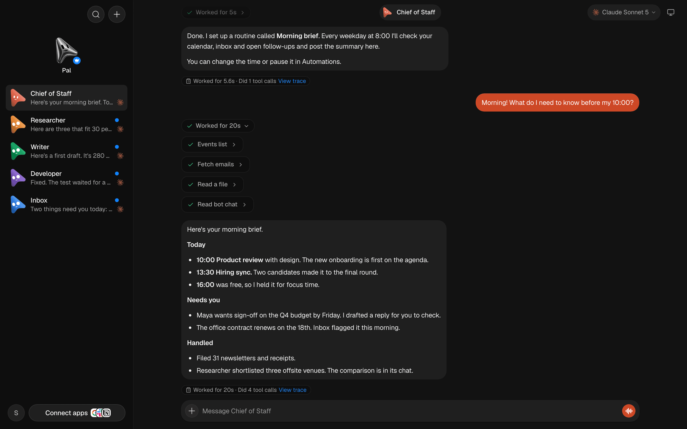
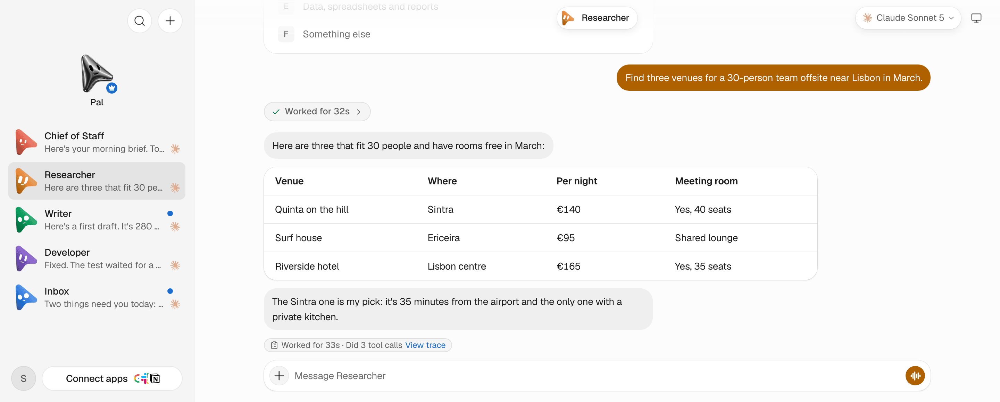
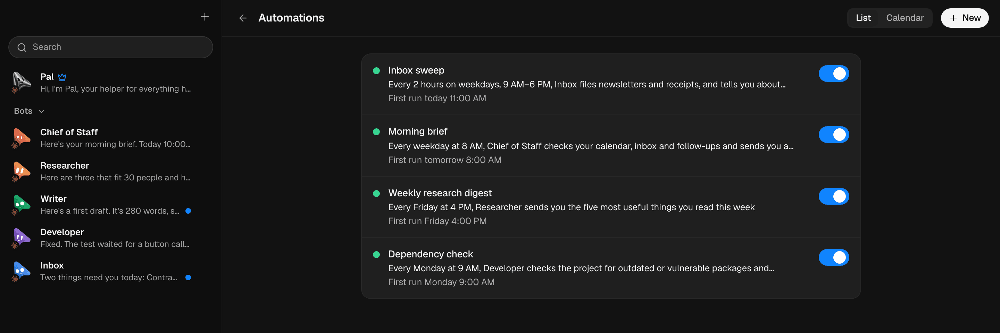
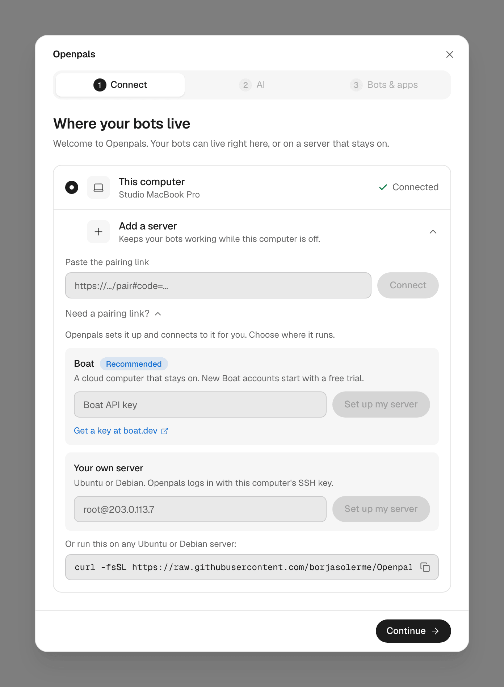
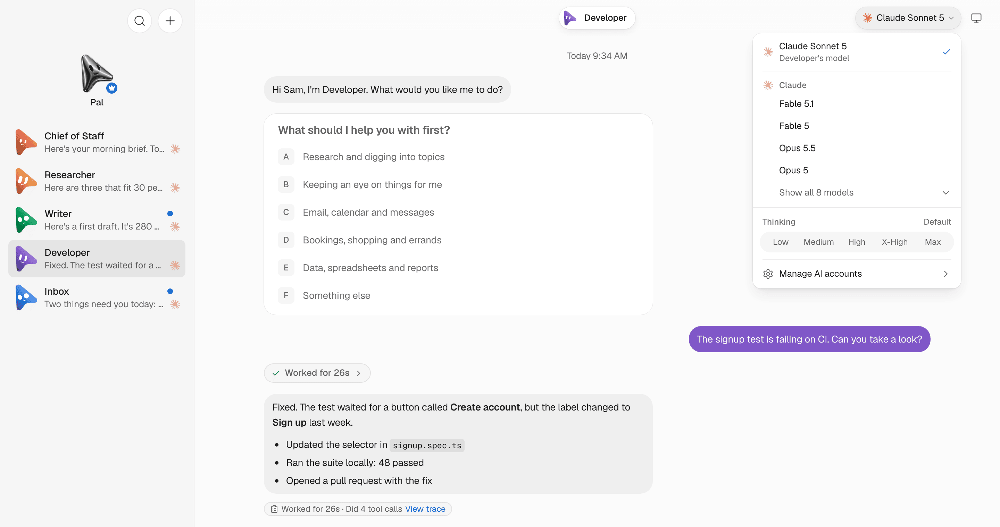
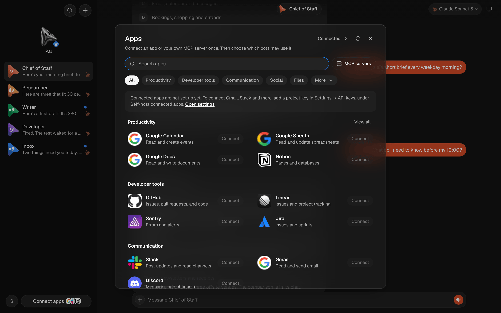

<h1 align="center">Openpals</h1>

<p align="center">
  <strong>Your own team of AI bots, in one simple chat app, on a computer you control.</strong>
</p>

<p align="center">
  <a href="#getting-started">Getting started</a> ·
  <a href="#quick-start">Quick start</a> ·
  <a href="#architecture">Architecture</a> ·
  <a href="docs/deploy-vps.md">Self-hosting</a> ·
  <a href="CONTRIBUTING.md">Contributing</a> ·
  <a href="#license">License</a>
</p>

> [!NOTE]
> Openpals is early. There is no download yet: you build the app from source, and some translations are still
> incomplete. Everything below that is marked as working runs today.



<p align="center"><sub><em>A Chief of Staff bot checks the calendar, the inbox and another bot's chat, then writes the morning brief.</em></sub></p>

---

## What is this, really?

Openpals is a chat app where every contact is an AI bot. You make a Researcher, a Writer, an Inbox helper, a
Developer, whatever you need, and you talk to each one in its own chat, like messaging a person.

Each bot has its own personality, memory, skills, routines and connected apps. It runs on the AI subscriptions you
already pay for, like Claude Code or Codex, so there is no new bill and no new account.

Your bots live on this computer or on an always-on server you own. Nothing goes through a hosted cloud of ours,
because there isn't one.

## Stuff you do in Openpals

- **Chat with a bot like a contact.** One chat per bot, a flat list of bots, and a helper bot called Pal that sets
  things up with you.
- **Hand off routines.** "Every weekday at 8, check my calendar and inbox and send me a brief." The result lands in
  the bot's chat.
- **Connect your apps.** Gmail, Calendar, Slack, GitHub, Notion and hundreds more through Composio, or any MCP
  server you run yourself. You choose which bots may use which app.
- **Keep bots working while your laptop sleeps.** Move them to an always-on server in one step, then use them from
  the desktop app, a browser or your phone.
- **Bring your bots over.** Move the bots you made in Grok Bot. Each one writes down its own setup, and Openpals
  rebuilds it here.

## A look inside

<table>
  <tr>
    <td width="50%" valign="top">
      
      <br>
      <sub><b>A flat list of bots.</b> Each bot keeps one chat, and replies can carry tables, files and code.</sub>
    </td>
    <td width="50%" valign="top">
      
      <br>
      <sub><b>Routines in plain words.</b> Daily, weekly, every few hours, or on a cron schedule, each with a bot that runs it.</sub>
    </td>
  </tr>
  <tr>
    <td width="50%" valign="top">
      
      <br>
      <sub><b>Pick where your bots live.</b> This computer, or a server the app sets up for you with a Boat key or SSH.</sub>
    </td>
    <td width="50%" valign="top">
      
      <br>
      <sub><b>Any model you already pay for.</b> Each bot picks its own engine, model and thinking level.</sub>
    </td>
  </tr>
</table>



<p align="center"><sub><b>Connect an app once,</b> then choose which bots may use it. Your own MCP servers sit next to the catalog.</sub></p>

## Why Openpals

Grok Bot, Meta Muse, OpenAI dots and Cue by Manus showed that a personal team of AI helpers is useful. They also
live on someone else's servers, on someone else's plan, with your data in someone else's account. Openpals is the
open-source take: the same idea, on machines you control, with your own keys.

It runs on the agent CLIs you already use. Claude Code and Codex are the main engines, and Cursor, OpenCode, Gemini,
GitHub Copilot and several others plug in the same way. When a better model ships, your bots can switch to it
without moving anywhere.

It stays simple on purpose. Openpals is a fork of [OpenMausBot](https://github.com/milind-soni/OpenMausBot) by
Milind Soni, cut down to feel like a messaging app: no thread lists, no departments, no places switcher, no hosted
cloud, plans, promos, telemetry or auto-updater. Removed features are deleted from the code, not hidden.

## Three little stories

**The Monday brief.** A Chief of Staff bot runs at 8:00 on weekdays. It reads the calendar, skims the inbox, asks the
Researcher how the venue search is going, and posts five lines before you've had coffee.

**The laptop that closed.** You started an inbox sweep at your desk and closed the lid for a train ride. The bots
live on a small always-on server, so the sweep finished anyway, and the summary was waiting on your phone when you
sat down.

**The bug that fixed itself overnight.** A Developer bot noticed a failing signup test, found the renamed button
and handed the fix to T3 Code on a dev machine with `t3 thread start`. In the morning there was a pull request
waiting. (That last hop is a personal setup, not a built-in feature. Bots can run any command you allow.)

## Where things stand

| ✅ Works today | 🚧 Being wired up | 💭 Ideas |
| --- | --- | --- |
| • One chat per bot, Pal the helper bot, a flat bot list<br>• Engines: Claude Code, Codex, Cursor, OpenCode, Gemini, GitHub Copilot and more<br>• Routines on daily, weekly, interval or cron schedules<br>• Memory and skills per bot<br>• Apps through Composio (project or personal key) and your own MCP servers<br>• Group chats with several bots<br>• Approvals before risky actions<br>• Always-on server set up from the app (Boat or SSH) or with a one-line installer<br>• A cloud desktop and browser per bot on Boat<br>• Phone pairing with a one-time link, and notifications<br>• Voice calls and dictation<br>• Moving bots over from Grok Bot<br>• 16 interface languages | • Finishing translations: German, French, Hindi and Ukrainian are under half done<br>• A new Openpals mascot and logo<br>• Renaming the documentation site | • Image generation in chat<br>• Email on any mail host, not only Gmail<br>• Meeting notes<br>• More voices |

<sub>Translation coverage comes from <code>pnpm i18n:check</code>. Ideas are things worth considering, not promises.</sub>

## Getting started

### I want to try it on my computer

You need macOS (Linux is in beta), **Node 24+**, **pnpm**, and at least one agent CLI installed and signed in:
[`claude`](https://claude.com/claude-code) or [`codex`](https://github.com/openai/codex). Then build the desktop
app:

```bash
git clone https://github.com/borjasolerme/Openpals && cd Openpals
corepack pnpm@10.33.0 install
pnpm package:mac        # or: pnpm package:linux
```

The app lands in `release/`. Open it, keep **This computer**, sign in to your AI, and Pal takes it from there.

### I want my bots always on

Open the app, choose **Add a server**, and pick one:

- **Boat.** Paste a [Boat](https://boat.dev) API key. The app creates a cloud computer that stays on and installs
  Openpals on it.
- **Your own server.** Type the `user@address` of an Ubuntu or Debian server. The app logs in with this computer's
  SSH key and installs Openpals.

Or run the installer on the server yourself:

```bash
curl -fsSL https://raw.githubusercontent.com/borjasolerme/Openpals/main/scripts/install-server.sh | bash -s --
```

Without `--public-url` it serves `https://<public-ip>.sslip.io` through Caddy (ports 80 and 443 must be open). With
`--public-url https://your-address` it uses an HTTPS address you already have, and `--label "My server"` names it.
Either way it installs Openpals as a service and prints a one-time pairing link to paste into the app. For
Tailscale and other options, see [docs/deploy-vps.md](docs/deploy-vps.md).

### I want to hack on it

Read [CONTRIBUTING.md](CONTRIBUTING.md) first; it's short. Then run the server and the app from source with the
quick start below. Changes to the server or a conversation get checked against an isolated fixture with a fake
engine, never your real data: see [docs/verification/README.md](docs/verification/README.md).

## Quick start

**Once:**

```bash
# Node 24+ and pnpm 10.33.0
git clone https://github.com/borjasolerme/Openpals && cd Openpals
corepack pnpm@10.33.0 install
```

**Every day:**

```bash
# the Openpals server → 127.0.0.1:8799
pnpm dev:server

# the app in a browser → http://127.0.0.1:5199
pnpm dev

# or the desktop shell around the dev app
pnpm dev:desktop
```

**Before a pull request:**

```bash
pnpm typecheck
pnpm test:unit
pnpm test:e2e
```

## Architecture

```
┌──────────────────┐   ┌──────────────┐   ┌──────────────┐
│  Desktop app     │   │  Phone       │   │  Browser     │
│  (Electron)      │   │  (paired)    │   │              │
└────────┬─────────┘   └──────┬───────┘   └──────┬───────┘
         └────────────────────┼──────────────────┘
                              │  HTTPS + pairing link
                 ┌────────────▼─────────────┐
                 │  Openpals server (Node)  │
                 │  bots · chats · routines │
                 │  memory · skills · MCP   │
                 │  sessions · pairing      │
                 └──────┬─────────────┬─────┘
                        │             │
          ┌─────────────▼───┐   ┌─────▼──────────────────────┐
          │  Engines        │   │  Apps and computers        │
          │  Claude Code    │   │  Composio · MCP servers    │
          │  Codex · Cursor │   │  this computer · Boat      │
          │  OpenCode · …   │   │  cloud desktops · VMs      │
          └─────────────────┘   └────────────────────────────┘
```

The server owns the bots and their state; every screen, on any device, is a window onto one server.

<details>
<summary>Component map</summary>

| Path | What lives there |
| --- | --- |
| `src/` | The React app: chats, bot list, settings, automations, onboarding |
| `electron/` | The desktop shell, including server setup over Boat (`boat-setup.mjs`) and SSH (`ssh-setup.mjs`) |
| `server/` | The Node server: bots, chats, routines, memory, MCP, Composio, approvals, pairing |
| `server/drivers/` | One driver per engine (Claude Code, Codex, and the ACP engines in `acp/`) |
| `shared/` | Wire types shared by the app and the server |
| `companion/` | The opt-in sidecar that serves paired devices |
| `scripts/install-server.sh` | The one-line server installer |
| `apps/docs/` | The documentation site |
| `skills/`, `evals/` | Built-in skills and the evaluation suite |

</details>

## Going further

- **[Self-hosting on a VPS](docs/deploy-vps.md)**: the one-command install, Docker, Tailscale, updates and backups.
- **[Routine schedules](docs/routine-schedules.md)**: how daily, interval and cron routines run.
- **[Memory](docs/memory.md)**: what bots remember, and how to edit it or make them forget.
- **[Composio](docs/composio.md)** and **[custom MCP servers](docs/custom-mcp-servers.md)**: connecting apps.
- **[Custom engines](docs/custom-engines.md)**: plugging in another agent CLI.
- **[Phone web app](docs/phone-web-app.md)**: using your bots from your phone.
- **[Localization](docs/localization.md)**: adding or finishing a language.

<details>
<summary>Configuration</summary>

- Everything lives in one data folder on the machine the server runs on: bots, chats, memory, routines and
  `config.json`. Back up that folder and you've backed up your bots.
- Engines sign in with their own CLIs (`claude`, `codex`, …), so your bots run on the plans you already have.
- Composio takes a project key (`ak_…`) in **Settings → API keys**, or a personal key (`ck_…`) during the first run.
  MCP servers are added in **Apps → MCP servers**.
- The installer takes `--public-url https://…` for an address you already have and `--label "…"` for the name the
  app shows.

</details>

<details>
<summary>Common dev commands</summary>

```bash
pnpm dev:server          # the server, from source
pnpm dev                 # the app, from source
pnpm dev:desktop         # the Electron shell
pnpm typecheck           # TypeScript for the app and the server
pnpm lint                # oxlint
pnpm test:unit           # fast tests
pnpm test:e2e            # end-to-end tests against fixture servers
pnpm i18n:check          # translation coverage per language
pnpm docs:dev            # the documentation site
pnpm package:mac         # build the macOS app into release/
pnpm package:linux       # build the Linux app into release/
```

</details>

## Community

Found a bug or have an idea? Open an issue at
[github.com/borjasolerme/Openpals/issues](https://github.com/borjasolerme/Openpals/issues). Pull requests are
welcome: read [CONTRIBUTING.md](CONTRIBUTING.md), follow the [code of conduct](CODE_OF_CONDUCT.md), and report
security problems privately as described in [SECURITY.md](SECURITY.md).

## What it is not

- Not a hosted service. There is no Openpals cloud, account or plan.
- Not a new AI model. Your bots think with the engines you already use.
- Not a workflow builder. You talk to bots; there is no canvas of boxes and arrows.
- Not a team chat for people. It's your bots and you.
- Not finished. Some languages are half translated and you build it yourself for now.

**What it is:** a small, open-source chat app that gives you a team of AI bots that keep working on your own
computer or server.

## Credits

Built on [OpenMausBot](https://github.com/milind-soni/OpenMausBot) © 2026 Milind Soni and OpenMausBot
contributors, and the third-party work listed in [NOTICE](NOTICE). Changes in this fork © 2026 Borja Soler.

## License

[Apache License 2.0](LICENSE). See [NOTICE](NOTICE) for attributions and [LICENSING.md](LICENSING.md) for
details. OpenMausBot's source-available `enterprise/` folder is not part of Openpals.

Packaged Cua Driver components keep their upstream MIT, SIL OFL 1.1, MPL-2.0 and other terms; their notices,
license texts and SBOM are in [`third_party/cua-driver/`](third_party/cua-driver/).

Openpals is an independent project. It is not affiliated with or endorsed by Milind Soni or the OpenMausBot
project, xAI, Meta, OpenAI or Manus. "OpenMausBot", "MausBot", "Grok", "Muse", "dots" and "Cue" are trademarks
of their respective owners.

---

<p align="center"><sub>Openpals · Apache 2.0 · Made for people who want their AI helpers on their own machines.</sub></p>
